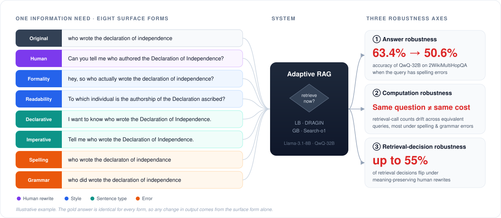

<div align="center">

# How You Ask Matters!<br>Adaptive RAG Robustness to Query Variations

**[Yunah Jang](mailto:vn2209@snu.ac.kr)<sup>1</sup> · Megha Sundriyal<sup>2</sup> · Kyomin Jung<sup>1†</sup> · Meeyoung Cha<sup>2†</sup>**

<sup>1</sup>Seoul National University &nbsp;&nbsp; <sup>2</sup>Max Planck Institute for Security and Privacy
<br><sup>†</sup>Co-corresponding authors

**EMNLP 2026 (Main)**

<a href="https://arxiv.org/abs/2604.10745"></a>
<a href="https://yunahjang.github.io/howyouaskmatters"></a>
<a href="https://huggingface.co/datasets/YunahJang/query-robustness"></a>
<a href="https://2026.emnlp.org/"></a>
<a href="#licensing-and-attribution"></a>
<a href="https://github.com/YunahJang/AdaptiveRAG-Robustness/stargazers"></a>

<br><br>



</div>

> **TL;DR** — Ask an Adaptive RAG system the *same* question in a slightly different way and it may decide differently whether to retrieve, spend a different amount of compute, and return a different answer. We build a 27K-query benchmark of meaning-preserving variations (model-generated + human-written) and show that better accuracy does **not** imply better robustness.

<br>

## 📑 Contents

- [Overview](#-overview)
- [Benchmark](#-benchmark)
- [Experimental Setup](#-experimental-setup)
- [Key Findings](#-key-findings)
- [Repository Structure](#-repository-structure)
- [Installation](#-installation)
- [Usage](#-usage)
- [Data](#-data)
- [Citation](#-citation)

## 🔍 Overview

Adaptive Retrieval-Augmented Generation (RAG) dynamically determines **when** retrieval is needed, improving both accuracy and efficiency. However, users can express the same information need in many different ways.

In this work, we systematically study the robustness of Adaptive RAG to **meaning-preserving query variations**. We introduce a large-scale benchmark containing both **model-generated query variations** and **human-written rewrites**, and evaluate robustness along three dimensions:

| | Dimension | Question we ask |
| :---: | --- | --- |
| 🎯 | **Answer Robustness** | Does the system produce consistent and correct answers? |
| ⚙️ | **Computation Robustness** | Does computational cost remain stable across equivalent queries? |
| 🔀 | **Retrieval Decision Robustness** | Does the system consistently decide when retrieval is necessary? |

Our results reveal a substantial robustness gap: even semantically equivalent queries can lead to different retrieval decisions, retrieval trajectories, computational costs, and final answers.

## 📊 Benchmark

We build on six widely used QA benchmarks, using the 500-question test subsamples distributed by [Adaptive-RAG](https://github.com/starsuzi/Adaptive-RAG).

<table>
<tr>
<th>Single-hop QA</th>
<th>Multi-hop QA</th>
</tr>
<tr>
<td>

- Natural Questions (NQ)
- TriviaQA
- SQuAD v1.1

</td>
<td>

- 2WikiMultiHopQA
- HotpotQA
- MuSiQue

</td>
</tr>
</table>

Each query is paired with controlled **model-generated variations** across three categories, plus **human-written rewrites** collected from annotators:

| Category | Variation | Illustrative example |
| --- | --- | --- |
| — | Original | *who wrote the declaration of independence* |
| 👤 Human | Human rewrite | *Can you tell me who authored the Declaration of Independence?* |
| 🎨 Style | Formality | *hey, so who actually wrote the declaration of independence?* |
| 🎨 Style | Readability | *To which individual is the authorship of the Declaration ascribed?* |
| 📝 Sentence Type | Declarative | *I want to know who wrote the Declaration of Independence.* |
| 📝 Sentence Type | Imperative | *Tell me who wrote the Declaration of Independence.* |
| ⚠️ Error | Spelling | *who wrote the declaraton of independance* |
| ⚠️ Error | Grammar | *who did wrote the declaration of independence* |

<sub>Examples are illustrative, not drawn from the released data. The gold answers are identical across every form of a question.</sub>

## 🧪 Experimental Setup

| | |
| --- | --- |
| **Adaptive RAG methods** | **LB** — logit-based retrieval control ([DRAGIN](https://github.com/oneal2000/DRAGIN)) · **GB** — generation-based retrieval control ([Search-o1](https://github.com/RUC-NLPIR/Search-o1)) |
| **Reference baselines** | **NR** — no retrieval · **SR** — single retrieval |
| **Models** | Llama-3.1-8B-Instruct · QwQ-32B |
| **Retrievers** | BM25 (sparse, main) · Contriever (dense) |

## 💡 Key Findings

1. **Better performance ≠ greater robustness.** Larger models score higher, but their robustness does not improve to the same degree.
2. **Human rewrites and surface-level errors hurt the most.** Every method and model we tested is vulnerable to them.
3. **Equivalent queries, different behavior.** Semantically equivalent queries trigger different retrieval decisions and computational costs.
4. **Subquery drift.** Human-written queries can push intermediate subqueries away from the original retrieval trajectory …
5. **… which breaks retrieval.** This drift leads to failures in retrieving relevant evidence and ultimately degrades answer accuracy.

## 📁 Repository Structure

```text
AdaptiveRAG-Robustness/
├── data_construction/        query-variation generation and dataset building
│   ├── rewrite_queries.py            style / sentence-type / error variations
│   ├── rewrite_queries_grammarerror.py   grammar errors, verified with LanguageTool
│   ├── prompts.py, models.py         rewrite prompts and the OpenAI wrapper
│   ├── jsonl_to_adaptiverag_csv.py   variation JSONL -> the CSV the runners read
│   ├── human_annotation_to_csv.py    annotator TSV export -> csv / jsonl
│   └── build_final_dataset.py        the public release files
├── baselines_overlay/        the files we changed in / added to the two baseline repos
│   ├── apply_overlay.sh              copies them over freshly cloned repos
│   ├── AdaRAGUE/                     NR / SR / DRAGIN: runners, retrievers, configs
│   └── Search-o1/                    Search-o1 driven by our local retriever
├── assets/                   figures for this README
├── requirements.txt
└── README.md
```

> [!NOTE]
> The baseline frameworks themselves are not vendored here: they are cloned from their original repositories and our files are copied over the clone. See [`baselines_overlay/README.md`](baselines_overlay/README.md).

## 🔧 Installation

```bash
git clone https://github.com/YunahJang/AdaptiveRAG-Robustness.git QueryRobustness
cd QueryRobustness
export QR_ROOT="$PWD"          # every script falls back to this layout anyway
pip install -r requirements.txt

export OPENAI_API_KEY=...      # LLM query rewriting
export HF_TOKEN=...            # gated Llama checkpoints
```

Then clone the two baseline frameworks and apply our overlay:

```bash
mkdir -p $QR_ROOT/baselines && cd $QR_ROOT/baselines
git clone https://github.com/s-nlp/AdaRAGUE.git
git clone https://github.com/RUC-NLPIR/Search-o1.git
$QR_ROOT/baselines_overlay/apply_overlay.sh
```

Follow each upstream README for its environment (AdaRAGUE needs spaCy + Elasticsearch, Search-o1 needs vLLM).

<details>
<summary><b>Expected directory layout</b></summary>

All paths are derived from `$QR_ROOT`:

```text
$QR_ROOT/processed_data/{dataset}/test_subsampled*.jsonl   # queries + variations
$QR_ROOT/datasets/data/dpr/psgs_w100.tsv                   # retrieval corpus
$QR_ROOT/indexes/contriever_psgs_w100_fp16_stream/         # dense index
$QR_ROOT/baselines/{AdaRAGUE,Search-o1}/                   # cloned baselines
```

</details>

## 🚀 Usage

The pipeline has four stages:

```text
 ① Query variations  ──▶  ② Retrieval setup  ──▶  ③ Inference  ──▶  ④ Evaluation
   data_construction/       BM25 / Contriever       NR·SR·LB·GB       evaluate.py
```

### ① Query variations

Starting point: `processed_data/{dataset}/test_subsampled.jsonl`, the 500-question subsample of each benchmark in the Adaptive-RAG JSONL format.

```bash
cd data_construction

# LLM rewrites: style and sentence type
python rewrite_queries.py --dataset squad --variations formality readability
python rewrite_queries.py --dataset squad --variations declarative imperative

# surface errors (nlpaug, no API calls)
python rewrite_queries.py --dataset squad --variations spelling_error keyboard_error ocr_error

# grammar errors: LLM rewrite, verified with LanguageTool
python rewrite_queries_grammarerror.py

# human rewrites collected by annotators
python human_annotation_to_csv.py

# convert every variation into the CSV layout the runners read
python jsonl_to_adaptiverag_csv.py
```

Each variation file adds one field, `{variation}_variation`, beside the original `question_text`; `jsonl_to_adaptiverag_csv.py` promotes it to `question_text` and writes `baselines/AdaRAGUE/data/adaptive_rag_{dataset}/test_{variation}.csv`.

### ② Retrieval setup

BM25 (used by the main configs) runs on a local Elasticsearch:

```bash
bash $QR_ROOT/baselines/AdaRAGUE/standard_retriever/run_elastic.sh
python $QR_ROOT/baselines/AdaRAGUE/dragin/prep_elastic.py \
    --data_path $QR_ROOT/datasets/data/dpr/psgs_w100.tsv --index_name wiki
```

Contriever instead builds a FAISS index:

```bash
python $QR_ROOT/baselines/AdaRAGUE/dragin/src/build_contriever_index.py
```

### ③ Inference

| Tag | Method | Runner |
| :---: | --- | --- |
| NR | no retrieval | `dragin/src/main_newstore.py` with `wo-RAG_*.json` |
| SR | single retrieval | `dragin/src/main_newstore.py` with `SR-RAG_*.json` |
| LB | DRAGIN (logit-based) | `dragin/src/main_newstore.py` with `DRAGIN_*.json` |
| GB | Search-o1 (generation-based) | `Search-o1/scripts/run_search_o1_local.py` |

One config per (model, dataset, variation, method); all of them ship under `baselines_overlay/AdaRAGUE/dragin/{Llama_3.1_8B_Instruct,qwq32b}/`.

```bash
# NR / SR / DRAGIN
cd $QR_ROOT/baselines/AdaRAGUE/dragin
python ./src/main_newstore.py -c ./Llama_3.1_8B_Instruct/adaptive_rag_squad/DRAGIN_original.json

# Search-o1
cd $QR_ROOT/baselines/Search-o1/scripts
python run_search_o1_local.py --dataset_name squad --split test \
    --model_path "meta-llama/Llama-3.1-8B-Instruct" --retriever BM25 \
    --data_path $QR_ROOT/baselines/AdaRAGUE/data/adaptive_rag_squad/test.csv \
    --style original
```

Every run gets its own directory with `config.json` and `output.txt`. Re-running the same config creates `<name>-1`, `<name>-2`, ... so repeated runs can be averaged.

> [!TIP]
> Config files ship with a `<QR_ROOT>` placeholder in `data_path`; the runners expand it from `$QR_ROOT`, or infer it from the config location.

### ④ Evaluation

`evaluate.py` scores one run directory: it reads `output.txt`, re-extracts the final answer from each generation and compares it with the gold answers.

```bash
cd $QR_ROOT/baselines/AdaRAGUE/dragin

# NR / SR / DRAGIN runs
python ./src/evaluate.py --dir ./result_final_debug/Llama_3.1_8B_Instruct_adaptive_rag_squad/dragin_original

# Search-o1 runs are scored with the same evaluator
python ./src/evaluate.py --dir $QR_ROOT/baselines/Search-o1/scripts/outputs/runs.baselines/squad.llama-3.1-8b.search_o1_local.original
```

It writes two files into the run directory:

| File | Contents |
| --- | --- |
| `details.txt` | one JSON line per question: `qid`, `question`, `ground_truth`, `final_pred`, `EM`, `F1`, `Accuracy` |
| `result.tsv` | run averages: EM, F1, Precision, Recall, Accuracy, plus the retrieval/generation counters (`retrieve_count`, `generate_count`, `hallucinated_count`, `token_count`, `sentence_count`) |

Robustness is read off these per-run scores: the same command is repeated for every variation of a dataset, and each variation is compared against the `original` run of the same method and model.

> [!IMPORTANT]
> - Most scripts keep their configuration in a block at the top of the file (model, dataset, method); edit it before running.
> - The `.sh` files are SLURM job scripts from our cluster. Adapt the `#SBATCH` header and the conda activation line to your environment.
> - The LLM rewrites call the OpenAI API (default `gpt-5-mini`) and therefore cost money; everything else runs locally.

## 📦 Data

The benchmark is released on Hugging Face: **[`YunahJang/query-robustness`](https://huggingface.co/datasets/YunahJang/query-robustness)**.

```python
from datasets import load_dataset

ds = load_dataset("YunahJang/query-robustness")
```

It contains model-generated query variations and human-written rewrites constructed from six QA datasets. Questions are the 500-question subsamples (`dev_500_subsampled`) distributed by [Adaptive-RAG](https://github.com/starsuzi/Adaptive-RAG); the gold answers are identical across every form of a question, so any change in system output is attributable to the query surface form alone.

`data_construction/build_final_dataset.py` assembles the release files (one JSONL per benchmark, plus a combined file). Each record holds:

- the original question and the gold answers,
- the six model-generated variations,
- for a 100-question subset per benchmark, 1–4 human rewrites.

Retrieval contexts are not included.

### Licensing and attribution

The six source benchmarks keep their own licenses, three of which carry a ShareAlike condition:

| Dataset | License |
| --- | --- |
| [SQuAD](https://rajpurkar.github.io/SQuAD-explorer/) | [CC BY-SA 4.0](https://creativecommons.org/licenses/by-sa/4.0/) |
| [Natural Questions](https://ai.google.com/research/NaturalQuestions) | [CC BY-SA 3.0](https://creativecommons.org/licenses/by-sa/3.0/) |
| [TriviaQA](https://nlp.cs.washington.edu/triviaqa/) | [Apache 2.0](https://www.apache.org/licenses/LICENSE-2.0) |
| [HotpotQA](https://hotpotqa.github.io/) | [CC BY-SA 4.0](https://creativecommons.org/licenses/by-sa/4.0/) |
| [2WikiMultiHopQA](https://github.com/Alab-NII/2wikimultihop) | [Apache 2.0](https://www.apache.org/licenses/LICENSE-2.0) |
| [MuSiQue](https://github.com/StonyBrookNLP/musique) | [CC BY 4.0](https://creativecommons.org/licenses/by/4.0/) |

Because of the ShareAlike terms, the released query set is distributed under [CC BY-SA 4.0](https://creativecommons.org/licenses/by-sa/4.0/); attribute the source benchmark of the config you use and indicate any modifications.

`baselines_overlay/` contains files we modified in, or added to, two MIT-licensed projects — [AdaRAGUE](https://github.com/s-nlp/AdaRAGUE) and [Search-o1](https://github.com/RUC-NLPIR/Search-o1). Each such file carries a header naming its origin and license, and the upstream license texts are included at `baselines_overlay/AdaRAGUE/LICENSE` and `baselines_overlay/Search-o1/LICENSE`.

## 📝 Citation

If you find this work useful, please cite:

```bibtex
@article{jang2026howyouaskmatters,
  title   = {How You Ask Matters! Adaptive RAG Robustness to Query Variations},
  author  = {Jang, Yunah and Sundriyal, Megha and Jung, Kyomin and Cha, Meeyoung},
  journal = {arXiv preprint arXiv:2604.10745},
  year    = {2026}
}
```

<sub>The EMNLP 2026 proceedings citation will replace this entry once it is available.</sub>

## 🙏 Acknowledgements

This project builds on [Adaptive-RAG](https://github.com/starsuzi/Adaptive-RAG), [AdaRAGUE](https://github.com/s-nlp/AdaRAGUE), [DRAGIN](https://github.com/oneal2000/DRAGIN) and [Search-o1](https://github.com/RUC-NLPIR/Search-o1). We thank their authors for releasing their code and data.

## 📬 Contact

For questions or issues, please [open an issue](https://github.com/YunahJang/AdaptiveRAG-Robustness/issues) in this repository or contact Yunah Jang ([vn2209@snu.ac.kr](mailto:vn2209@snu.ac.kr)).
